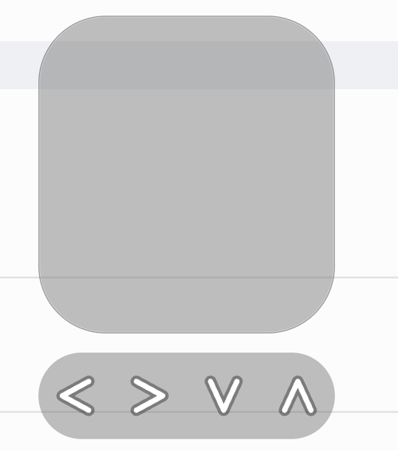
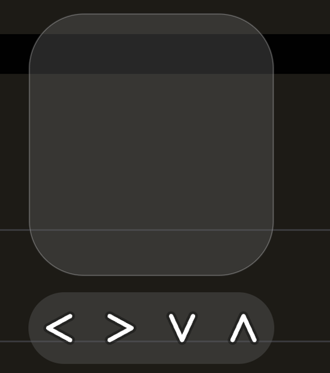
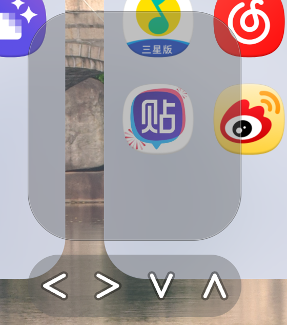
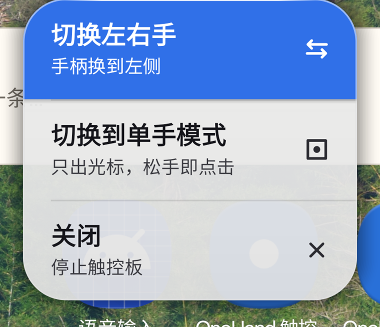

# OneHand 触控板

为大屏手机单手操作而做的屏幕边缘虚拟触控板。

`许可证 GPL-3.0-only` · `Android 11 (API 30)+` · `无需 Root` · `不含网络权限`

## 它解决什么问题

大屏手机越来越难单手够到屏幕左上角，返回、关闭、搜索和输入框往往都在另一侧。

系统自带的单手模式只是把画面缩小，手指仍要在整块屏幕上寻找目标。

OneHand 触控板把屏幕边缘变成拇指可达的控制区：从侧边手柄向内拖动后，屏幕上出现光标，其他位置的点击和滑动由应用代为完成。

它面向日常浏览、聊天、阅读和大屏单手使用，不要求 Root，也不依赖云端账户。

## 功能

| 功能 | 说明 |
| --- | --- |
| 侧边手柄 | 常驻屏幕左边缘或右边缘，可调整厚度与长度。 |
| 拖出触控板 | 从手柄向内拖动超过约 6 mm 后展开；基准设备上的完整窗口约为 432×617 px。 |
| 组件缩放 | 面板尺寸可在 0.1×–2.0× 范围内缩放；这是当前源码和设置页允许的范围。 |
| 光标移动 | 在面板或光标显示期间移动手指，按位移与速度驱动光标。 |
| 光标点击 | 短按后原地抬起，在光标位置执行一次点击。 |
| 长按 | 按住约 600 ms 后，在光标位置执行长按。 |
| 长按拖动 | 可选开启；长按后继续移动手指可保持按下并拖动。当前默认关闭。 |
| 四方向滑动 | 底部四格依次为左、右、下、上；短按后从光标位置向对应方向滑动。 |
| 单击模式 | 面板不弹出；从手柄拖出时只显示光标，松手即在光标处点击。 |
| 快捷菜单 | 将面板拖向对侧边缘后出现，可切换左右手、切换操作模式或停止触控板。 |
| 光标方位切换 | 展开后点击面板下方的独立长条，可在上方与屏幕内侧之间切换光标位置。 |
| 位置调整 | 长按侧边手柄后上下拖动，可调整手柄的垂直位置。 |
| 设置页 | 单屏仪表集中显示开关状态、组件大小、光标灵敏度、手柄厚度与长度。 |
| 调试抽屉 | 设置页底部提供日志、探针和 Shizuku 注入入口，默认不记录高频调试日志。 |
| 首次启动引导 | 依次处理无障碍、可选 Shizuku 和完成状态；完成后进入常规仪表。 |
| 本地隐私 | 不申请网络、账户或分析权限，不读取窗口内容。 |

## 截图

以下展示触控板在浅色、深色和照片背景上的观感，以及拖到对侧后出现的快捷菜单。

## 工作原理

### 触摸与绘制

触控板、光标、侧边切换长条和快捷菜单由应用自己的 `View` 子类绘制。

首选窗口类型是 `TYPE_ACCESSIBILITY_OVERLAY`，因此不需要普通的悬浮窗授权；如果系统拒绝无障碍覆盖窗口，代码会尝试回退到 `TYPE_APPLICATION_OVERLAY`。

面板窗口在创建后保持宽高不变。侧边停靠只改变窗口的横向位置，左右两侧共用同一套几何；拖动展开和收回时可能同时更新横纵坐标，但不会通过修改窗口尺寸来做缩放动画。

### 点击注入

主路径使用 `AccessibilityService.dispatchGesture`。`GestureInjector` 负责点击、滑动、长按以及手势忙碌时的排队和时序。

光标坐标来自屏幕像素坐标。应用先在覆盖层中接收拇指操作，再向光标所在位置派发系统手势。

### 可选增强

安装 Shizuku 后，可以在调试抽屉中启用“Shizuku 注入”。

该路径通过 Shizuku 用户服务调用系统输入通道，由 `ShizukuInjector` 管理连接、权限、事件时序与失败回退。

Shizuku 不是必需品。未安装、未运行、未授权或连接断开时，应用继续使用无障碍手势路径。

### 为什么需要无障碍权限

无障碍服务允许普通应用创建可触摸的覆盖窗口，并具备向其他应用派发手势的能力。这是本项目无需 Root 就能在任意屏幕坐标完成点击和滑动的基础。

本项目不调用 `getRootInActiveWindow`、`getWindows` 或节点查询 API。`PadService.onAccessibilityEvent` 保持为空实现；服务只处理自身生命周期、覆盖窗口和手势注入。

因此，“不读取屏幕内容”是指不获取界面节点树、文本或窗口内容，而不是声称应用不会收到 Android 为无障碍服务配置的生命周期回调。

## 安装

### 要求

- Android 11（API 30）或更高版本。
- 不需要 Root。
- 自行构建时，产物位于 `build/onehand.apk`。
- 如果仓库后续提供 Releases，也可以从对应版本附件下载 APK。

### 开启

1. 安装 APK 并打开“OneHand 触控板”。
2. 按首次启动引导进入系统设置。
3. 打开“设置 → 无障碍 → OneHand 触控板”。
4. 返回应用，确认状态显示为“运行中”。
5. 如果状态仍为“已停止”，再按页面提示进入无障碍详情页手动开启。

### 可选 Shizuku

安装并启动 Shizuku、授予本应用权限后，在设置页底部打开调试抽屉并启用“Shizuku 注入”。

仅安装 Shizuku 不会自动切换通道；只有在通道开关开启且 Shizuku 连接可用时才使用它。

### 厂商系统

三星、小米、华为等系统可能通过电池优化或后台清理停止无障碍服务。

如果在锁屏、清理后台或长时间闲置后发现触控板失效，请将本应用设为“不受限制”，并允许其在后台运行。

## 使用

| 动作 | 结果 |
| --- | --- |
| 从侧边手柄向屏幕内拖动超过约 6 mm | 展开面板和光标；单击模式下只显示光标。 |
| 展开后移动手指 | 光标按位移、移动速度和灵敏度移动。 |
| 在面板内短按后原地抬起 | 在光标位置点击；落在底部箭头上的按下会改为方向滑动。 |
| 按住约 600 ms | 在光标位置长按。 |
| 长按后继续拖动（需开启选项） | 保持按下并随光标拖动；默认关闭。 |
| 短按底部左、右、下、上四格 | 从光标位置向对应方向滑动约屏幕尺寸的 35%。 |
| 点击面板下方的上下双箭头长条 | 在光标“上方”与“屏幕内侧”之间切换。 |
| 将面板拖到对侧边缘 | 打开快捷菜单；上下移动选择，松手执行。 |
| 点击快捷菜单第一项 | 切换手柄到屏幕另一侧。 |
| 点击快捷菜单第二项 | 在全功能模式与单击模式之间切换。 |
| 点击快捷菜单第三项 | 停止触控板并关闭无障碍服务。 |
| 在面板外点击 | 收回面板。 |
| 长按手柄后上下拖动 | 调整手柄的垂直位置。 |

## 构建

- Android SDK 默认为 `/opt/android-sdk`，也可用 `ANDROID_SDK_ROOT` 指定。
- 在仓库根目录运行 `bash tools/build.sh`。
- 成功产物为 `build/onehand.apk`。

完整依赖、签名和安装说明见 [docs/BUILDING.md](docs/BUILDING.md)。

## 已知限制

- 界面目前只有中文。
- 尚未针对折叠屏和平板做专门布局适配。
- 部分厂商 ROM 会严格限制无障碍服务或后台存活。
- 纯无障碍路径下的“长按后拖动”可靠性受系统手势注入限制，因此默认关闭。
- 未在 Google Play 上架；无障碍权限类应用在应用商店上架通常受到额外限制。

## 贡献

问题反馈、复现步骤和代码贡献要求见 [CONTRIBUTING.md](CONTRIBUTING.md)。

架构说明见 [docs/ARCHITECTURE.md](docs/ARCHITECTURE.md)，常见问题见 [docs/TROUBLESHOOTING.md](docs/TROUBLESHOOTING.md)。

## 许可

本项目以 `GPL-3.0-only` 发布，完整条款见 [LICENSE](LICENSE)。

这意味着如果你分发修改版，必须同样以 GNU GPL v3 开放对应源码。不能把修改后的二进制以更严格的专有许可单独分发。

`libs/` 中 Shizuku 组件的来源与 Apache License 2.0 文本见 [THIRD_PARTY_NOTICES.md](THIRD_PARTY_NOTICES.md)。
