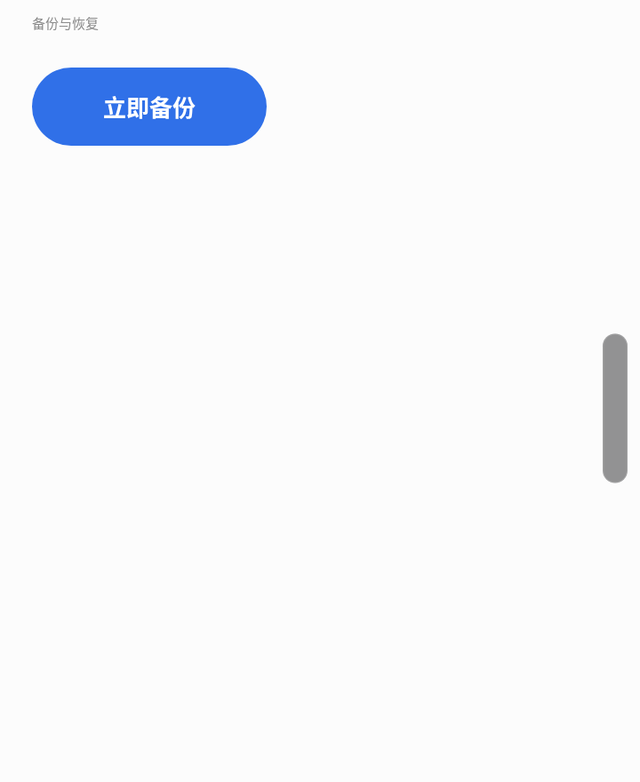
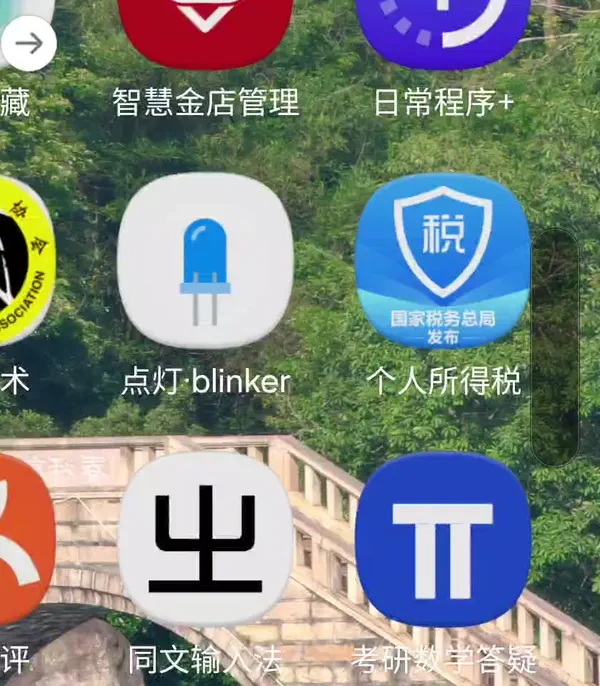

# OneHand 触控板

大屏手机的单手操作补丁：屏幕边缘留一条竖条，往内一拖就是一块触控板，光标按你的偏移跨过去。拇指不用再够屏幕对角。

`GPL-3.0-only` · `Android 11+` · `无需 Root` · `不含网络权限`

## 它能干什么

- **拉出即用**——从竖条往内拖，面板展开、光标跟着走；松手就是一次点击，按住约 600 ms 是长按。
- **不用够对角**——四格方向条负责滑动：点哪格，就在光标处朝那个方向滑一次。
- **不想换手**——把面板拖到对侧边缘，顶部弹出菜单：换左右手、切模式、关掉触控板。
- **找不回应用**——双击手柄，「最近使用」从手柄那一侧滑出，点一行切回去。

## 看一眼

**拉出面板并点击** —— 手指只走一小段，光标按灵敏度跨到对角，抬手即点击。

**四方向滑动** —— 点方向条哪一格，就在光标位置朝那个方向注入一次滑动（约屏幕 35%）；指针不动，动的是画面。

**拖到对侧：换手、切模式或关闭** —— 不松手把面板拖到对侧边缘，顶部出现三行菜单；手指上下移动选中，松手执行。

**双击手柄打开「最近使用」** —— 抽屉从手柄那一侧滑出，当前应用整行填蓝并排第一；点一行切回去，点行内的 × 关掉它。

**长按手柄调整吸附位置** —— 长按竖条约 0.6 秒进入调整模式，竖条变蓝，上下拖动改变位置，松手保存。

## 需要什么

| | 作用 | 没有它会怎样 |
|---|---|---|
| **无障碍服务**（必须） | 注入手势、读前台窗口 | 完全不能用 |
| **Shizuku**（可选） | 真实任务列表、切回 / 关闭任务、准确高亮当前应用 | 触控板照常；「最近使用」降级成按最近用过的**应用**记录——只能重新打开（浏览器会回首页），**没有 × 关闭按钮** |

＊注：无障碍权限里那句「查看屏幕内容」只用来读**输入法窗口的位置**——键盘弹起时把手柄抬到键盘上方、收起后回原位。它不读取、不保存、不上传任何屏幕内容；应用本身连网络权限都没有。

## 安装

1. 从 Releases 下载 `onehand.apk` 安装。
2. 打开应用，按引导开启无障碍服务。
3. 要用任务切换器的话，再装 [Shizuku](https://shizuku.rikka.app/)，在应用里授权。

## 更多

[用法与手势](docs/USAGE.md) · [常见问题](docs/TROUBLESHOOTING.md) · [架构](docs/ARCHITECTURE.md) · [构建](docs/BUILDING.md)

## 许可

`GPL-3.0-only`，见 [LICENSE](LICENSE) 与 [THIRD_PARTY_NOTICES.md](THIRD_PARTY_NOTICES.md)。
