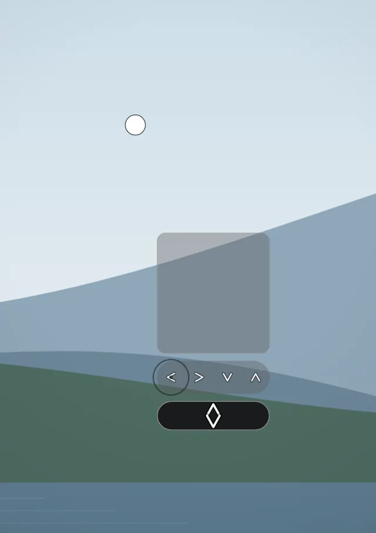
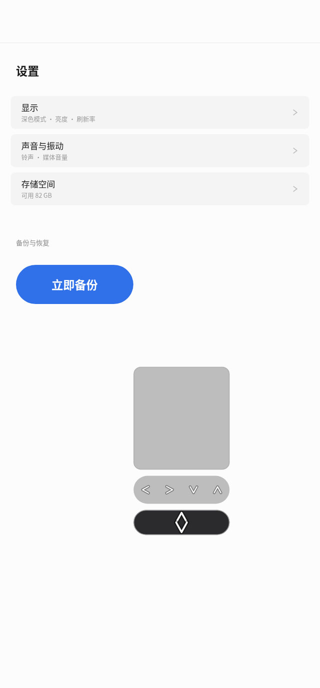

# OneHand 触控板

为大屏手机单手操作而做的屏幕边缘虚拟触控板：从侧边手柄拖出，整块屏幕变成触控板，拇指不用再够到屏幕对角。

`GPL-3.0-only` · `Android 11+` · `无需 Root` · `不含网络权限`

## 功能

- 侧边手柄：常驻屏幕左边缘或右边缘，可调整厚度与长度。
- 拖出触控板：从手柄向内拖动超过约 6 mm 后展开。
- 光标移动：在面板或光标显示期间移动手指，按位移与速度驱动光标。
- 光标点击与长按：短按后原地抬起执行点击；按住约 600 ms 后执行长按。
- 长按拖动：可选开启；长按后继续移动手指可保持按下并拖动，当前默认关闭。
- 四方向滑动：底部四格依次为左、右、下、上；短按后从光标位置向对应方向滑动。
- 单击模式：面板不弹出；从手柄拖出时只显示光标，松手即在光标处点击。
- 快捷菜单：将面板拖向对侧边缘后出现，可切换左右手、切换操作模式或停止触控板。
- 光标方位切换：展开后点击面板下方的独立长条，可在上方与屏幕内侧之间切换光标位置。
- 位置调整：长按侧边手柄后上下拖动，可调整手柄的垂直位置。

## 演示

三段示意动画（`docs/demo/`，各约 3 秒，演示用的 mock 界面）对应三条最常用的操作路径：

**拉出面板并点击** —— 按住侧边手柄向内拖，面板与光标一起出现；手指只走一小段，光标按灵敏度跨到对角，抬手即点击。

**四方向滑动** —— 点方向条哪一格，就在光标位置朝那个方向注入一次滑动（约屏幕 35%）；指针不动，动的是画面。

**拖到对侧：换手、切模式或关闭** —— 不松手把面板拖到对侧边缘，顶部出现三行菜单；手指上下移动选中，松手执行。

## 兼容性

- Android 11（API 30）或更高版本；无需 Root。
- 依赖无障碍权限；另声明悬浮窗与振动权限，不申请网络权限。
- Shizuku 为可选增强；未安装、未运行、未授权或连接断开时继续使用无障碍手势路径。
- 三星、小米、华为等系统可能通过电池优化或后台清理停止无障碍服务，建议设为“不受限制”并允许后台运行。
- 界面目前只有中文；尚未针对折叠屏和平板做专门布局适配。
- 纯无障碍路径下的“长按后拖动”可靠性受系统手势注入限制，因此默认关闭。

## 安装

1. 从 Releases 下载 APK。
2. 打开“OneHand 触控板”，按首次启动引导开启无障碍服务。
3. 返回应用，确认状态显示为“运行中”。

## 构建

- 运行 `bash tools/build.sh`，产物位于 `build/onehand.apk`。
- 完整依赖、签名和安装说明见 [docs/BUILDING.md](docs/BUILDING.md)。

## 相关文档

- 常见问题见 [docs/TROUBLESHOOTING.md](docs/TROUBLESHOOTING.md)。
- 架构说明见 [docs/ARCHITECTURE.md](docs/ARCHITECTURE.md)。
- 贡献要求见 [CONTRIBUTING.md](CONTRIBUTING.md)。

## 许可

本项目以 `GPL-3.0-only` 发布，完整条款见 [LICENSE](LICENSE)，第三方组件许可见 [THIRD_PARTY_NOTICES.md](THIRD_PARTY_NOTICES.md)。
